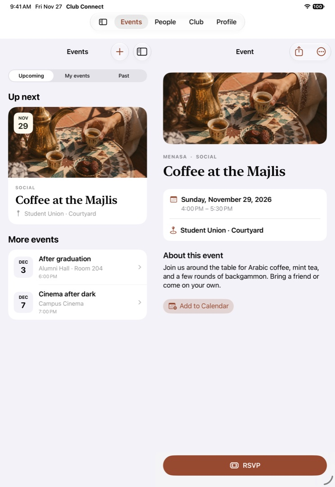

# Club Connect

Club Connect is a native iPhone and iPad app for the Middle Eastern and North African Association (MENASA). Students and alumni can find each other, share events, RSVP, add events to Calendar, and check in with an in-app ticket or a signed Apple Wallet pass.

 

## Try the pilot

Open the **ClubConnect** scheme in `ClubConnect.xcodeproj` with Xcode 27.2. Select an iPhone or iPad and run. The minimum deployment target is iOS 17. The checked-in project builds directly. To regenerate it after editing `project.yml`, run `xcodegen generate` with XcodeGen 2.49.0.

- **Continue with Apple** joins the live MENASA community. A new member chooses a display name. Profile details and photos are visible to other members. In Profile, a member can sign out or delete their account.
- **Explore the sample community** opens fictional student and alumni profiles and three upcoming campus events. Sample changes persist on that device. Organizers can try publishing an event and checking in their own sample ticket. Wallet passes are issued for live events.
- **Organizers** redeem their private one-time invitation in Profile. The club page includes the public invitation, editable identity, colors and logo. Saved events appear in the community's Events tab.
- **At the door**, open the event's organizer menu and choose **Check in members**. Scan the member's QR code or enter their ticket code. The shared backend binds the ticket to the event and records a single successful check-in.
- **Internal TestFlight** uses the MENASA Pilot group. Internal testers need eligible App Store Connect user access. The club invitation opens the app for someone who has installed it. TestFlight enrollment is managed separately. [App Store Connect](https://appstoreconnect.apple.com/apps/6840182659/testflight) · [Club invitation](https://redab2.github.io/clubconnect/?club=menasa)

## Shared service

The pilot uses Supabase Auth, PostgreSQL, and an Edge Function that signs Wallet passes. The iOS app contains the public project URL and publishable key. Account permissions, organizer invitations, and ticket ownership are checked in PostgreSQL. The server stores only a digest of each one-time organizer invitation. Wallet signing keys belong in Edge Function secrets.

Database migrations are in `supabase/migrations`. The rollback-only regression in `supabase/tests/pilot_flows.sql` runs with an administrative PostgreSQL connection and exercises both member and organizer access. UI tests are in `ClubConnectUITests`. Select **Product → Test** with an iPhone or iPad simulator.

The invitation page is maintained in `docs/` and served from the root of the `gh-pages` branch. Its Open button carries the club or event into the installed app. To publish changes to the invitation page, push the `docs/` subtree to `gh-pages`.

## Artwork

The sample coffee photo was created with built-in ImageGen and is bundled at [gathering.jpg](ClubConnect/Assets.xcassets/Gathering.imageset/gathering.jpg). The app icon and club mark use geometric artwork.

Image generation prompt

Use case: photorealistic-natural. A 3:2 horizontal editorial photograph for a Middle Eastern and North African student club's campus coffee gathering. Close and tactile, slightly overhead, late afternoon sun falls across a small round patterned tiled table, one hammered brass coffee pot, two ivory demitasse cups, a little dish of dates, edge of a linen sleeve and hand passing a cup. Rust terracotta tile, coffee-brown shadows, warm cream and faded teal details. Analog film grain, candid independent magazine photography, strong geometric shadows. Cut off table edges, no lettering, no words or graphics.

