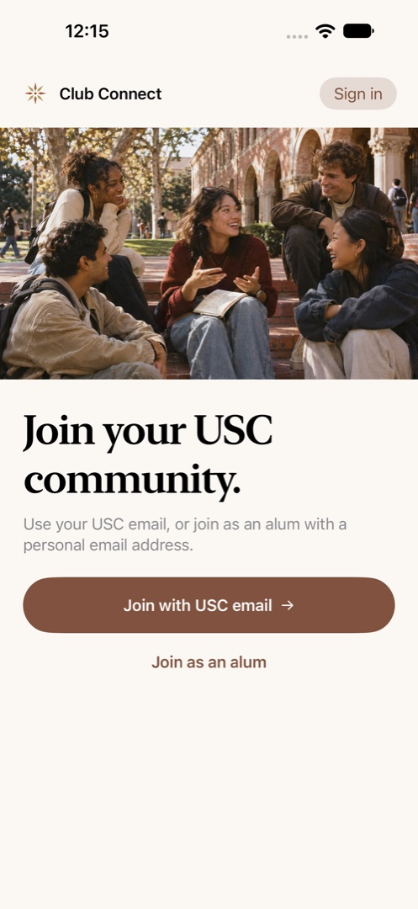
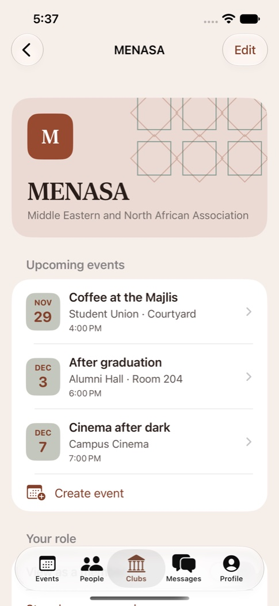
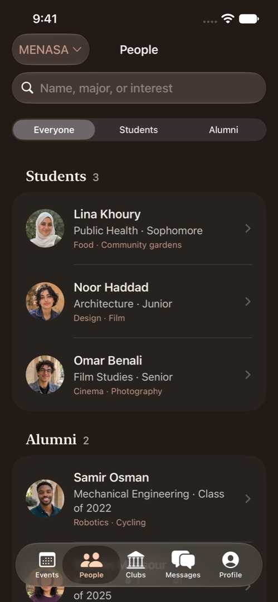
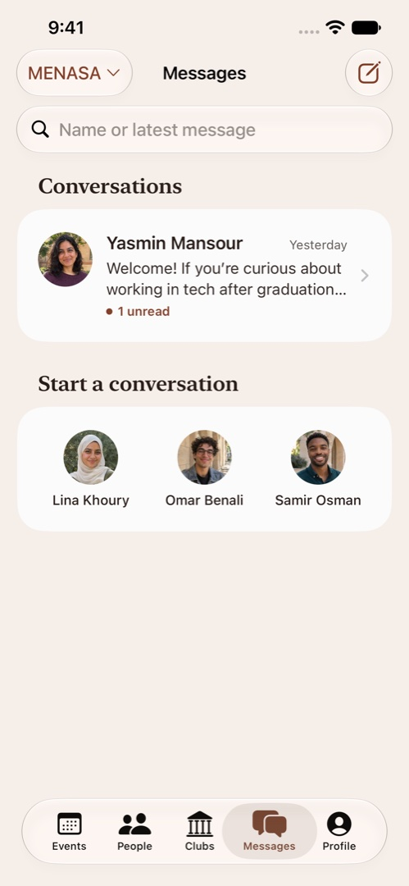
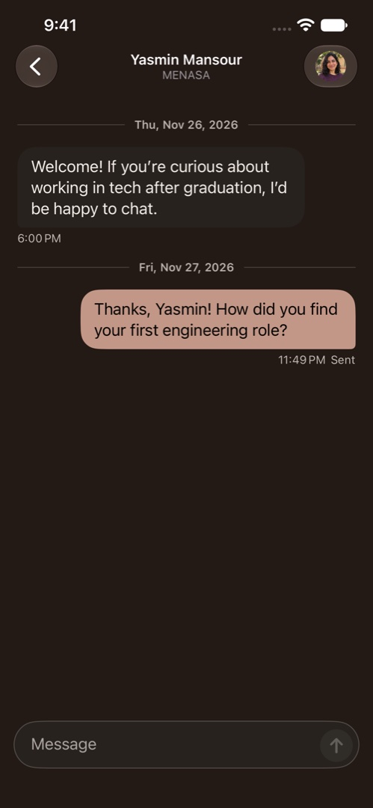
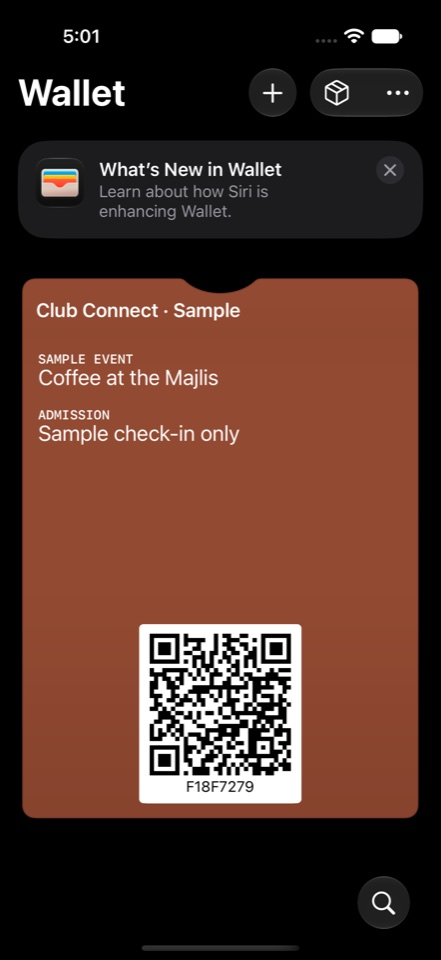
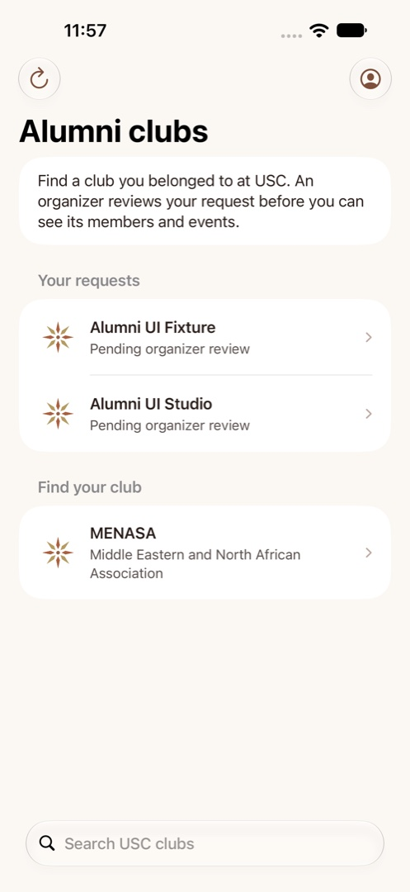
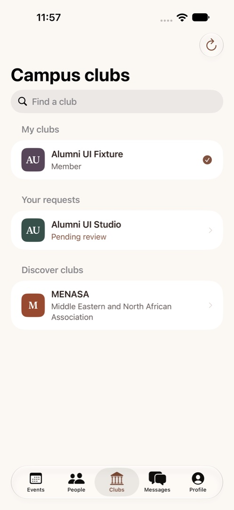
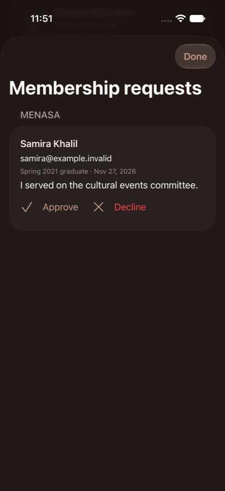
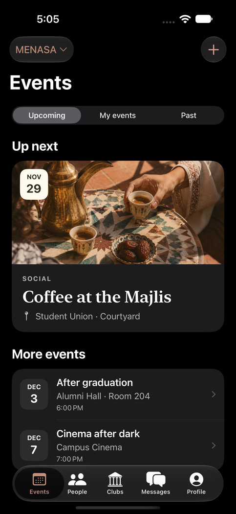

# Club Connect

A native iPhone and iPad community app for USC students and alumni. MENASA is the pilot club. Students can use a verified USC address across campus clubs. Alumni who have lost their USC address can create an account with a personal email and apply to individual clubs.

  

  

## Using the pilot

A brief animation of the Club Connect mark opens a cold launch. First-time visitors can swipe through three examples before signup. They show a club gathering, the ticket used at check-in, and a conversation with an alum. Skip or finish to go to account choices. People opening a shared link go directly to that flow, and returning members go straight back to their account.

[Watch the first-launch experience](media/first-launch.mp4)

1. Choose the USC sign-in path or **Join as an alum** with a personal email. A club link can take an alum directly into signup. Open the verification link on the device that started sign-in, or enter the email’s six-digit code in the app. Both expire after ten minutes.
2. Enter a name, graduation term, and year, then choose your first club. A personal-email alum saves a profile before applying to any clubs. USC account holders can also create a club. Current students also choose freshman, sophomore, junior, senior, or graduate student. A spring graduate becomes an alum on June 1 and a fall graduate on January 1 of the following year, in Los Angeles time.
3. Use **Clubs** to find, join, or create clubs. Open a club to see its next three events. Tap a date to open the event, or **See all upcoming events** for a longer calendar. The club menu in Events, People, and Messages switches the active community.
4. The campus directory, account screens, and personal profile use Club Connect’s ivory, white, and brown palette. Each club’s page, event details, member directory, and conversations use its own colors. Organizers can change the logo and both colors in **Edit club**. **View as a member** hides management tools. **Step down as organizer** gives up the role. A sole organizer chooses a successor before stepping down. MENASA’s initial organizer can redeem the private invitation in Profile.
5. Open another member’s profile in People and tap **Message**, or start a conversation in **Messages**. Conversations belong to a club and only the participants can read them.
6. RSVP to an event and open **View ticket**. On a compatible iPhone, **Add to Apple Wallet** installs a signed pass with the same code used at check-in. The Calendar editor, share sheet, and manual or camera-assisted check-in use native iOS controls.
7. Members signed in with a verified USC address can open the fictional sample community from Clubs. Debug builds also offer a local preview from the welcome screen. Network features that issue Wallet passes require a verified account.

 

### Join with a personal email

1. Choose **Join as an alum**, verify your personal email, and create a profile with your name and a past graduation term. You can do this before choosing a club.
2. Find your former club and tap **Request to join**. You can include a short note about when you were involved. You can apply to several clubs at once. If MENASA approves you while another club is deciding, MENASA appears in **My clubs** and the other club stays under **Your requests**. Each organizer only reviews their own club’s applications.
3. The club’s organizer opens **Clubs → their club → Membership requests**, reviews the applicant’s name, verified email, graduation term, and note, then approves or declines. Each approval opens that club’s events, people, and messaging. An applicant can send a new request after a withdrawal or decline.
4. To point alumni at a particular club, use **Share alumni signup** on its page. The shared link selects the club. The recipient still needs an organizer’s approval. Installing the internal TestFlight build requires separate access to the beta.

  

For the comparison of onboarding approaches and the pilot design decision, see [Joining a club](design/onboarding.md).

### Test Apple Wallet on iPhone

1. Sign in with a verified USC email and complete your profile. Open **Clubs → Explore the sample community** and choose **MENASA**.
2. Open an upcoming event, such as **Coffee at the Majlis**, and tap **RSVP**. If you already have a reservation, tap **View ticket**.
3. Tap **Add to Apple Wallet**, then **Add** in Apple's sheet. Open Wallet and look for the sample pass. Adding a pass requires a network connection and a compatible iPhone.
4. To try check-in on that same phone, copy the code from the sample ticket. Open the event’s **Manage event → Check in members**, paste the code, and tap **Check in member**. The ticket will show **Checked in**. For a live event, an organizer can scan the attendee’s Wallet QR from a second device.

 

## Running and testing

Open the **ClubConnect** scheme in `ClubConnect.xcodeproj` with Xcode 27.2. The deployment target is iOS 17. Use **Product → Test** with an iPhone or iPad simulator. The project uses Swift Package Manager. To regenerate the Xcode project after editing `project.yml`, use XcodeGen 2.49.0.

The internal **MENASA Pilot** group is managed in [App Store Connect](https://appstoreconnect.apple.com/apps/6840182659/testflight). The [campus invitation](https://redab2.github.io/clubconnect/?club=menasa) opens the installed app. TestFlight enrollment is separate. The invitation page lives in `docs/` and is served from the `gh-pages` branch.

## Shared service

The hosted Supabase project runs email authentication, member-scoped PostgreSQL operations, direct messages, and an Edge Function for Wallet signing. The iOS app uses the public project URL and publishable key. The selected club never grants organizer authority on its own. Each privileged operation checks membership on the server. Wallet signing material stays in Edge Function secrets.

When a message is sent or read, Supabase Realtime signals the participants’ open inboxes. Each device retrieves new messages through the authenticated conversation API. The app also catches up after reconnecting.

Supabase sends verification emails through Resend as **Club Connect** (`clubconnect@mail.worldniche.app`). Its dedicated sending key is restricted to that domain and stored in the hosted project’s [Auth settings](https://supabase.com/dashboard/project/kdbuclwxzgndhpukxwrn/auth/smtp). The [email template](supabase/templates/sign-in.html) includes a same-device sign-in link and a six-digit code for first-time and returning members.

Versioned schema changes live in `supabase/migrations/`. The scripts in `supabase/tests/` run against a migrated database with an administrative PostgreSQL connection. They roll back their synthetic users, clubs, messages, and tickets.

## Artwork

The sample coffee photo was created with built-in ImageGen and is bundled at [gathering.jpg](ClubConnect/Assets.xcassets/Gathering.imageset/gathering.jpg). The welcome photo is an AI-generated campus scene. The five bundled portraits depict fictional members of the sample community and were created with OpenAI image generation. Live members choose their own profile photos. The app icon and club mark use geometric artwork.

Image generation prompt

Use case: photorealistic-natural. A 3:2 horizontal editorial photograph for a Middle Eastern and North African student club's campus coffee gathering. Close and tactile, slightly overhead, late afternoon sun falls across a small round patterned tiled table, one hammered brass coffee pot, two ivory demitasse cups, a little dish of dates, edge of a linen sleeve and hand passing a cup. Rust terracotta tile, coffee-brown shadows, warm cream and faded teal details. Analog film grain, candid independent magazine photography, strong geometric shadows. Cut off table edges, no lettering, no words or graphics.

